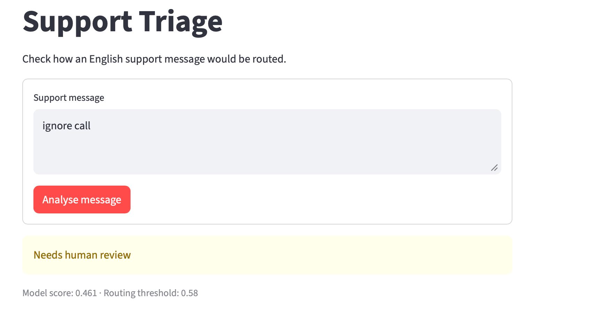
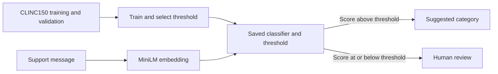

# Support Triage

[Try the live demo](https://support-triage-gv7yezupxew78ahbota8hz.streamlit.app)

Support Triage is a Streamlit demo that suggests an intent for an English
support message or marks it for human review when the model score is too low.
It uses MiniLM sentence embeddings and a logistic regression classifier trained
on CLINC150.



## Run locally

Use Python 3.12. From the project folder, run:

```bash
python3.12 -m venv .venv312
.venv312/bin/python -m pip install -r requirements.txt
.venv312/bin/python semantic.py
.venv312/bin/python -m streamlit run app.py
```

Open the URL shown in the terminal, usually `http://localhost:8501`.
Training downloads CLINC150 and the pinned MiniLM weights on the first run. It
writes `data/minilm-triage.joblib`, which contains the fitted classifier and
the routing threshold. The app loads the classifier and cached encoder on the
first analysis, then reuses them for later requests.

Try **Could you tell me the current balance of my checking account?** for an
automatic route or **ignore call** for human review.

## How it works



The classifier predicts one of 150 supported intents. “Human review” is a
recommendation shown in the demo. The model scores are used for routing and
can be high for incorrect predictions.

## Evaluation

Both models use logistic regression trained on the known-intent training split.
The TF-IDF baseline uses words and two-word phrases as features. MiniLM
represents each message as a 384-dimensional sentence embedding.

The initial MiniLM threshold of 0.58 was selected on validation data to match
the baseline's routing coverage as closely as possible. A follow-up sweep in
steps of 0.01 identified 0.53 as a candidate. On validation data, moving from
0.58 to 0.53 increased automatic routing from 68.0% to 73.4%, while accuracy
among routed messages decreased from 99.5% to 99.3%.

The table reports results on the same official CLINC150 test split of 4,500
known-intent and 1,000 out-of-scope messages.

| Model | Threshold | Automatically routed | Error among routed | Out-of-scope messages routed |
| --- | ---: | ---: | ---: | ---: |
| TF-IDF + logistic regression | 0.21 | 60.1% | 5.8% | 7.2% |
| MiniLM + logistic regression, initial setting | 0.58 | 57.6% | 1.1% | 1.7% |
| **MiniLM + logistic regression, live demo** | **0.53** | **61.8%** | **1.4%** | **2.2%** |

At 0.53, MiniLM automatically routed 4.2 percentage points more messages than
at 0.58, with a 0.3-point increase in error among routed messages. Compared
with the TF-IDF baseline, the live setting routed more messages and reduced
both error measures. An automatically routed out-of-scope message counts as
a routing error.

For example, TF-IDF routed “ignore call” to `make_call` with a score of 0.994.
MiniLM scored it at 0.461 and referred it for human review at the live threshold
of 0.53. For “lost debit card”, MiniLM ranked `report_lost_card` first at 0.439
and also referred the message for review.

Two official test rows match training or validation messages after case and
whitespace normalisation. All settings were evaluated on the full official
test split.

After training, reproduce the initial TF-IDF and MiniLM comparison with:

```bash
.venv312/bin/python compare_models.py
```

Run `.venv312/bin/python evaluate.py` for the baseline's detailed error analysis.

## CPU latency

Measured in a fresh Python process on Linux x86-64 with an AMD EPYC 7763,
Python 3.12.14, PyTorch 2.7.1 CPU, two OpenMP and BLAS threads and cached MiniLM
weights. Warm measurements use three example messages repeated ten times.

| Measurement | Time |
| --- | ---: |
| Model load | 4.28 s |
| First prediction after load | 35.3 ms |
| Warm single-message prediction, median | 11.8 ms |
| Warm single-message prediction, 95th percentile | 18.7 ms |

Run `.venv312/bin/python benchmark.py` to measure the same stages on your own
machine. These timings cover the Python model path. Browser latency and
first-time model downloads are outside the measurement.

## Data and model

- [CLINC150 dataset](https://github.com/clinc/oos-eval) and
  [original paper](https://aclanthology.org/D19-1131/).
- [MiniLM model and pinned revision](https://huggingface.co/sentence-transformers/all-MiniLM-L6-v2/tree/8b3219a92973c328a8e22fadcfa821b5dc75636a).
