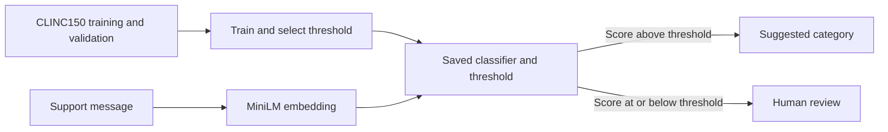

# Support Triage

Support Triage is a Streamlit demo that suggests an intent for an English
support message or marks it for human review when the model score is too low.
It uses MiniLM sentence embeddings and a logistic regression classifier trained
on CLINC150.


## Run locally

Use Python 3.12. From the project folder, run:

```bash
python3.12 -m venv .venv312
.venv312/bin/python -m pip install -r requirements.txt
.venv312/bin/python semantic.py
.venv312/bin/python -m streamlit run app.py
```

Open the URL shown in the terminal, usually `http://localhost:8501`.
Training downloads CLINC150 and the pinned MiniLM weights on the first run. It
writes `data/minilm-triage.joblib`, which contains the fitted classifier and
the routing threshold. The app loads the classifier and cached encoder on the
first analysis, then reuses them for later requests.

Try **Could you tell me the current balance of my checking account?** for an
automatic route or **ignore call** for human review.

## How it works



The classifier predicts one of 150 supported intents. “Human review” is a
recommendation shown in the demo. The model scores are used for routing and
can be high for incorrect predictions.

## Evaluation

Both models train on the known-intent training split. The baseline turns words
and two-word phrases into TF-IDF features. MiniLM turns sentences into
384-dimensional embeddings. Both use logistic regression for classification.

The baseline threshold was selected on validation data to maximise routing
coverage under two demo targets. The targets were 5% or less error among routed
messages and 10% or less routing of out-of-scope messages. The MiniLM threshold
was selected on the validation data to match baseline coverage as closely as
possible. Thresholds were then held fixed for scoring the official test splits,
which contain 4,500 known-intent and 1,000 out-of-scope messages.

| Model | Threshold | Messages routed | Error among routed | Out-of-scope messages routed |
| --- | ---: | ---: | ---: | ---: |
| TF-IDF + logistic regression | 0.21 | 60.1% | 5.8% | 7.2% |
| MiniLM + logistic regression | 0.58 | 57.6% | 1.1% | 1.7% |

An automatically routed out-of-scope message counts as a routing error. MiniLM
lowered that type of error and the overall error among routed messages, while
sending a slightly larger share of messages to review. The TF-IDF model routed
“ignore call” to `make_call` at a score of 0.994. MiniLM referred it for review
at a score of 0.461. The two models' scores are interpreted against their own
thresholds.

The results reflect the benchmark's mix of intents and out-of-scope examples.
Two official test rows match training or validation messages after case and
whitespace normalisation. Both models were evaluated on the full official split.

After training, reproduce the comparison:

```bash
.venv312/bin/python compare_models.py
```

Run `.venv312/bin/python evaluate.py` for the baseline's detailed error analysis.

## CPU latency

Measured in a fresh Python process on Linux x86-64 with an AMD EPYC 7763,
Python 3.12.14, PyTorch 2.7.1 CPU, two OpenMP and BLAS threads and cached MiniLM
weights. Warm measurements use three example messages repeated ten times.

| Measurement | Time |
| --- | ---: |
| Model load | 4.28 s |
| First prediction after load | 35.3 ms |
| Warm single-message prediction, median | 11.8 ms |
| Warm single-message prediction, 95th percentile | 18.7 ms |

Run `.venv312/bin/python benchmark.py` to measure the same stages on your own
machine. These timings cover the Python model path. Browser latency and
first-time model downloads are outside the measurement.

## Data and model

- [CLINC150 dataset](https://github.com/clinc/oos-eval) and
  [original paper](https://aclanthology.org/D19-1131/).
- [MiniLM model and pinned revision](https://huggingface.co/sentence-transformers/all-MiniLM-L6-v2/tree/8b3219a92973c328a8e22fadcfa821b5dc75636a).
